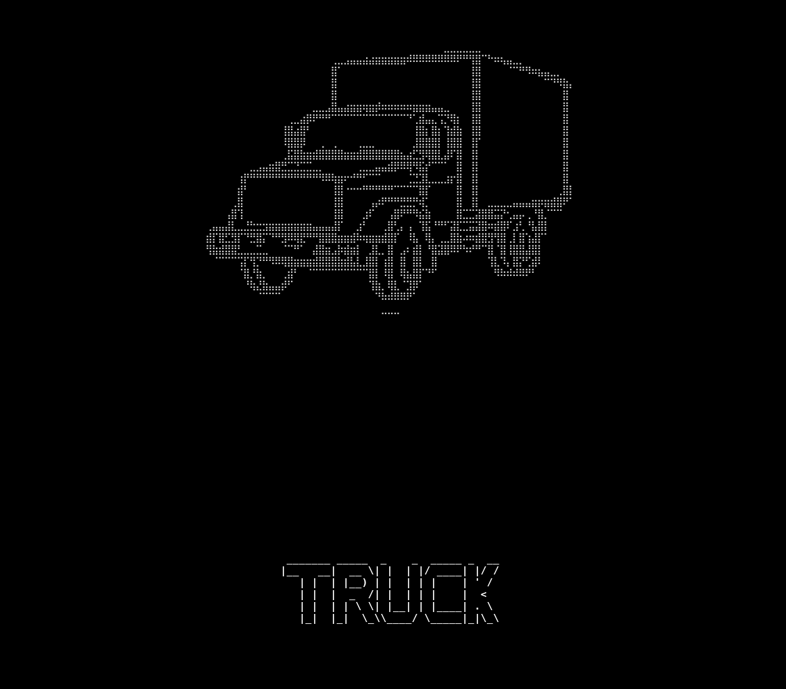
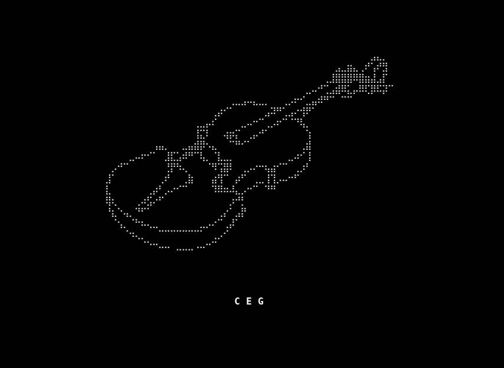

# Gil's Gadgets

Small computer toys for small children. You build them onto an SD card, put the card in a Raspberry Pi, and your child uses them with a keyboard, a music keyboard and a telephone. There is no mouse, no internet and no ads.

I made Gil's Gadgets for my son, Gil. Other parents can use them too.

**Website:** <https://agrathwohl.github.io/gils-gadgets/>

## Why

- **Offline.** Nothing on the card uses the internet. Wi-Fi is off. The telephone talks to the Pi over one cable, not over a network. There are no accounts, no updates and no ads.
- **Keys only.** There is no mouse and no pointer to chase around a screen. Your child presses a key or a phone button, and something happens. Every action is on purpose.
- **Letters, words and numbers.** The keys have letters on them. The typing game shows a letter, says it, and builds a word. The phone has numbers, and each number is a song. This is reading practice that feels like play.
- **Simple enough to use alone.** There are no menus, no scores, no timers and no "wrong" sounds. A child can explore and make things without a parent at their shoulder.
- **Curious about computers.** Your child sees a real computer, a real keyboard and a real terminal, not a locked tablet.

## The gadgets

| Gadget | What it does |
| --- | --- |
| [Typing game](typing-game/README.md) | A big letter shows. Your child types it. A picture shows a little more with each letter, and a voice says the letter. At the end, the voice says the word. |
| [Musical keyboard](musical-keyboard/README.md) | Plug in a USB MIDI keyboard and play real instrument sounds. A picture of the instrument fills the screen. |
| [Musical numbers](musical-numbers/README.md) | Pick up a real telephone and press one number. The phone plays the song for that number. |
| [Screen saver](screen-saver/README.md) | On a special day, big words and pictures move on the screen when nobody uses it. On Gil's birthday: "Happy Birthday Gil!" with a balloon and a cake. For the Pi 5 only. |

## Make an SD card

You need a Linux computer or an Apple Silicon Mac with [Nix](https://nixos.org/download/), a Raspberry Pi 4 or 5, and some basic skill with a terminal.

1. Get the code: `git clone https://github.com/agrathwohl/gils-gadgets.git`
2. Choose your Pi, your gadgets and your screen in [`gadgets.nix`](gadgets.nix).
3. Run `./build.sh`.
4. Write `result/sd-image/*.img.zst` to an SD card.

The [build guide](BUILD.md) gives every step, including how to install Nix on Linux or on a Mac with nix-darwin.

## Guides

- [Build guide](BUILD.md): install Nix, build the image, write the SD card.
- [Hardware guide](HARDWARE.md): what to buy and how to connect it.
- [Customize](CUSTOMIZE.md): add your own words, pictures, voices, instruments, songs and screen savers.

## What is in this repository

| Path | What it is |
| --- | --- |
| `gadgets.nix` | Your choices: which Pi, which gadgets, screen mode, MIDI keyboard name, phone account, time zone. |
| `build.sh` | Builds the SD card image. |
| `flake.nix`, `flake.lock` | The Nix build. It uses [nixos-raspberrypi](https://github.com/nvmd/nixos-raspberrypi). |
| `boards/` | Settings for each Raspberry Pi model. |
| `typing-game/` | The typing game. |
| `musical-keyboard/` | The musical keyboard. |
| `musical-numbers/` | The musical numbers. |
| `screen-saver/` | The screen saver. |
| `docs/` | The website. |

Each gadget is a folder with its code and a `gadget.nix` file that puts it on the card.

## License

GPLv3. See [LICENSE](LICENSE).
