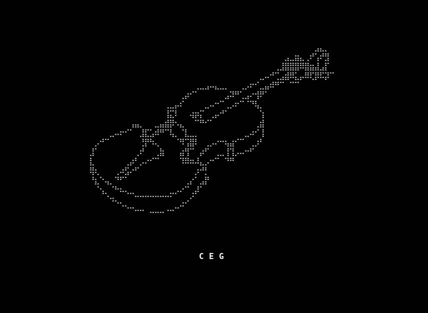
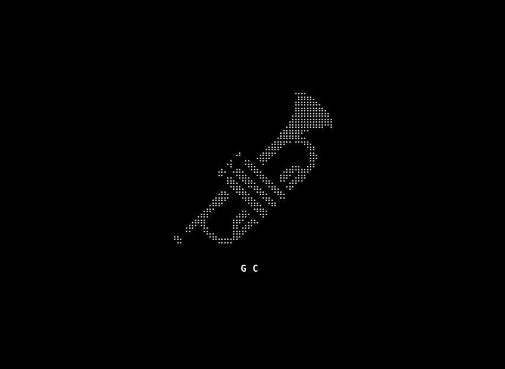
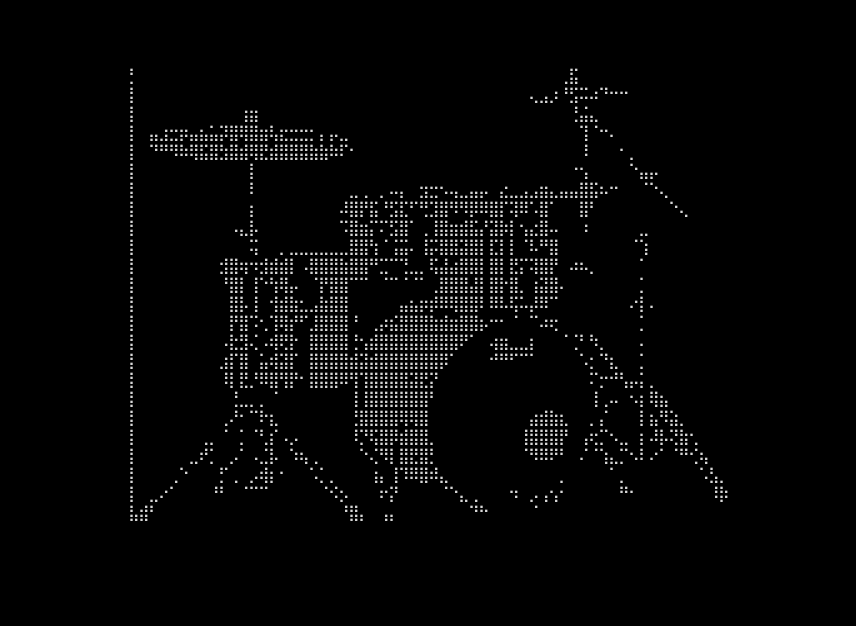

# Musical Keyboard

Plug a USB MIDI keyboard into the Raspberry Pi and play real instrument sounds. A big picture of the instrument fills the screen, and the names of the notes your child holds down show under it. There are no menus and nothing to set up. Press a key and hear a sound.







## How it plays

- **Piano keys** play the instrument on the screen.
- **Drum pads** (MIDI channel 10) play the drum kit on the screen. When the instrument is not a drum kit, the pads play drum kit 1.
- **Program change** goes to the next instrument. Most MIDI keyboards have a program change button or mode. See the manual of your keyboard.
- **Pitch bend, sustain and the knobs** go to the synthesizer as they are.
- **Any letter on the computer keyboard** closes the musical keyboard.

There are 21 instruments, in this order:

violin, double bass, clarinet, oboe, bassoon, saxophone, trombone, trumpet, tuba, grand piano, drum kit 1, drum kit 2, drum kit 3, drum kit 4, percussion 1, percussion 2, sound fx, electronic kit 1, electronic kit 2, electronic kit 3, electronic kit 4.

After the last one, it starts again at the violin.

## The soundfont

The sounds come from **Timbres of Heaven 3.4** by Don Allen, played by [FluidSynth](https://www.fluidsynth.org/). The author does not allow other sites to share it, so it is not in this repository ([license note](https://midkar.com/SoundFonts/index.html)). Get it yourself:

1. Download **TOH 3.4** from <https://midkar.com/SoundFonts/index.html>. It comes as a `.7z` archive.
2. Unpack it: `nix-shell -p p7zip --run '7z x <the .7z file>'`
3. Put the `.sf2` file in this folder (`musical-keyboard/`). Rename it to exactly this name:

   ```
   Timbres of Heaven GM_GS_XG_SFX V 3.4 Final.sf2
   ```

The file is about 395 MB. Git ignores it, but `./build.sh` puts it on the SD card. If the file is not there, the build stops and tells you.

## Run it on your computer

You need [uv](https://docs.astral.sh/uv/), `fluidsynth`, and `aseqdump` (from alsa-utils). Plug in your MIDI keyboard, then:

```sh
cd musical-keyboard
uv run python app.py
```

On NixOS, or anywhere with Nix: `nix-shell -p fluidsynth alsa-utils --run 'uv run python app.py'`

| Option | What it does |
| --- | --- |
| `--port NAME` | The name of your MIDI keyboard. The default is `MPK mini`. Run `aconnect -l` to see the names. |
| `--wait` | Stay hidden until the first note. After a letter closes it, wait again. |
| `--vt N` | With `--wait`: switch the screen to console N to show, then switch back. The Pi uses this. |

You can plug in the keyboard after the app starts: the app looks for it every second. If you unplug it while the app runs, restart the app (on the Pi: restart the Pi).

## On the Raspberry Pi

Set the name of your MIDI keyboard in [`gadgets.nix`](../gadgets.nix) (`midiKeyboard`).

- **With the typing game:** the typing game has the screen. The musical keyboard waits on the second console (tty2). Play a piano key or a drum pad, and the screen changes to the musical keyboard. A letter on the computer keyboard changes the screen back to the typing game.
- **Alone:** the musical keyboard shows on the screen at boot.

Sound goes to the 3.5 mm jack on a Pi 4 and to HDMI 0 on a Pi 5. See the [hardware guide](../HARDWARE.md).

To change the pictures or the instruments, see [Customize](../CUSTOMIZE.md#the-musical-keyboard).
