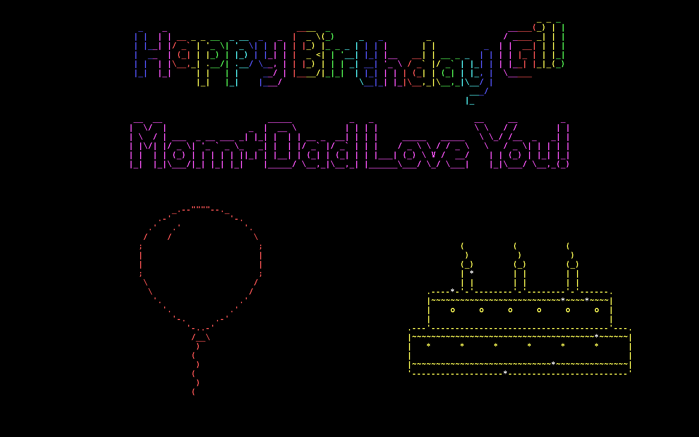

# Screen Saver

On a special day, big words and pictures move on the screen. The screen saver shows when nobody used the gadgets for a while, and a key press makes it go away. On Gil's birthday, it says "Happy Birthday Gil!" and "Mom+Dad Love You!", with a balloon and a cake.

The screen saver is for the Raspberry Pi 5 only ([why](../HARDWARE.md#clock-screen-saver)).



## How it works

- Each screen saver has a time, in crontab format. Gil's birthday screen saver can show during every minute of November 10.
- During that time, the Pi checks every minute. When no key was pressed and no screen changed for 10 minutes, the screen saver shows.
- Your child presses a key on the computer keyboard. The screen saver goes away, and the gadget from before shows again. That key does not go to the gadget.
- When the time is over, the screen saver does not show again. If it is on the screen at that moment, it stays until a key press.

Only the computer keyboard stops the screen saver. The music keyboard and the phone still play their sounds.

## The screen savers

The screen savers are in [`screensavers.toml`](screensavers.toml). Each one starts with its name in brackets:

```toml
["Gil's Birthday"]
when = "* * 10 11 *"
idle-minutes = 10
lines = [
  { text = "Happy Birthday Gil!", effects = ["rainbow", "wave"] },
  { text = "Mom+Dad Love You!", color = "magenta", effects = ["typewriter"] },
]
pictures = [
  { file = "pictures/balloon.txt", color = "red", effects = ["float"] },
  { file = "pictures/cake.txt", color = "yellow", effects = ["sparkle"] },
]
```

| Setting | What it is |
| --- | --- |
| `when` | The minutes when the screen saver can show, in [crontab format](https://man7.org/linux/man-pages/man5/crontab.5.html): minute, hour, day of month, month, day of week. `* * 10 11 *` is every minute of November 10. `* 8-19 24 12 *` is from 8:00 to 19:59 on December 24. |
| `idle-minutes` | Show the screen saver after this many minutes with no key press and no change on any screen. |
| `lines` | One or two lines of text in big letters. Each line has `text`, and it can have a `color` and `effects`. |
| `pictures` | None, one or two pictures. Each one has a `file`, and it can have a `color` and `effects`. A picture is a text file, like the [typing game pictures](../typing-game/README.md#words-pictures-and-voices). |

The colors are `red`, `yellow`, `green`, `cyan`, `blue`, `magenta` and `white`. White is the default.

## Effects

| Effect | What it does |
| --- | --- |
| `rainbow` | Stripes of all colors move across it. |
| `sparkle` | Little white stars twinkle on it. |
| `blink` | It goes on and off. |
| `wave` | A wave goes through it, from left to right. |
| `float` | It floats up and down and sways, like a balloon. |
| `bounce` | It bounces from side to side. |
| `scroll` | It comes in on the right and goes out on the left, again and again. |
| `shake` | It shakes for 1 second, every 4 seconds. |
| `typewriter` | It shows from left to right, a little at a time, and then starts again. |
| `drop` | It falls in from the top, stays for some seconds, and falls in again. |

A line or a picture can have more than one effect, for example `["rainbow", "wave"]`. Each effect stays in the space of its line or picture.

## Try it on your computer

You need [uv](https://docs.astral.sh/uv/).

```sh
cd screen-saver
uv run --with pyfiglet python screensaver.py "Gil's Birthday"
```

The screen saver shows at once. On your computer, it does not wait for the time or for the idle minutes. Press any key to stop it. Make the terminal big: in a narrow terminal, the big letters break onto more lines.

## On the Raspberry Pi

- Put `"screen-saver"` in `gadgets` in [`gadgets.nix`](../gadgets.nix), and set `timeZone` to your time zone. The times in `when` are in this time zone.
- The build makes one crontab line for each screen saver. Every minute in `when`, the line runs `screensaver.py --check`. It finds the last time that a program read a key or wrote to a screen on any console. The Linux kernel keeps this time on each terminal device file ([`tty_io.c`](https://github.com/torvalds/linux/blob/master/drivers/tty/tty_io.c)).
- The screen saver shows on its own console (tty9). When it stops, `openvt` switches back to the console from before ([`openvt.c`](https://github.com/legionus/kbd/blob/master/src/openvt.c)).

To make your own screen saver, see [Customize](../CUSTOMIZE.md#the-screen-saver).
