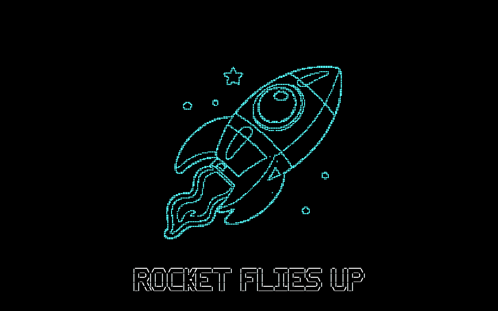
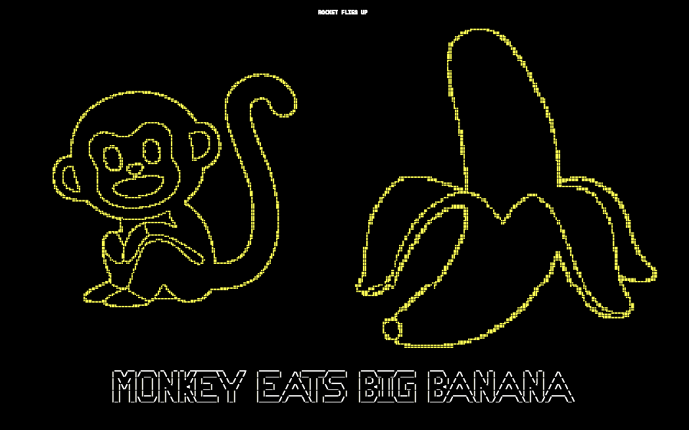
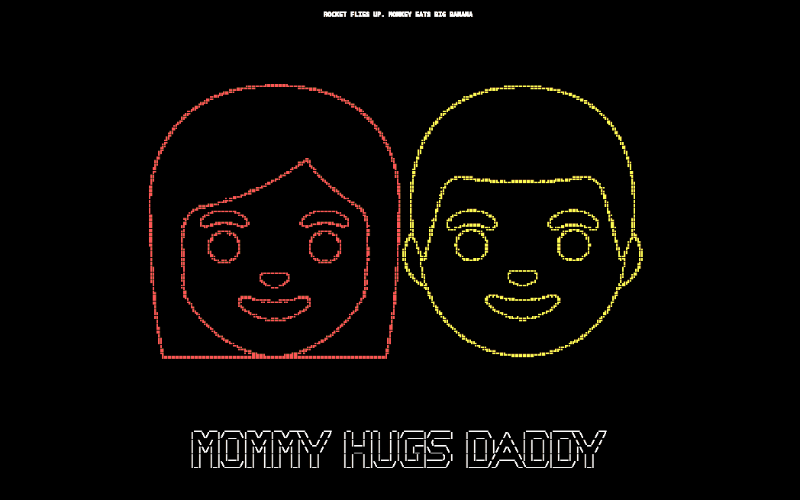

# Story

Your child says "story" and tells a story, one sentence after another. The pictures of the words show on the screen, and they move as the sentence says. The story listens through a microphone. It needs no keyboard and no internet.


## How it plays

- Your child says **"story"**. The story shows on the screen.
- Your child says a sentence, for example "the monkey eats the big banana". A monkey and a big banana show, the monkey eats the banana, and the words show in big letters.
- Each new sentence makes a new scene. The sentences from before stay in the top line.
- A sentence with no thing before its action is about the first thing of the sentence before. After "the dinosaur", the sentence "jumps up" makes the same dinosaur jump up.
- The story knows the names of its pictures, some actions and some descriptions. It ignores all other words. There is no score and no "wrong" sound.
- When the story hears no word that it knows for 3 minutes, it goes away, and the gadget from before shows again. A parent can also press **Esc**.

The story does not record your child. It keeps no sound and no text, and nothing leaves the Pi.







## The words

A sentence has things, an action and descriptions: "the **big** **dog** **jumps** **up**". All the words are in [`words.toml`](words.toml).

- Any thing can do any action. A house can jump, and a truck can eat a banana.
- A sentence uses its first two things and its first action.

### Things

Every picture is a thing, and the name of its file is its word. The story has 374 pictures for 303 things:

- 282 pictures in [`pictures/`](pictures/): animals, food, vehicles, people, weather, toys, things at home, places and plants.
- All the pictures of the [typing game](../typing-game/README.md#words-pictures-and-voices), the [musical keyboard](../musical-keyboard/README.md) and the [screen saver](../screen-saver/README.md).

A thing with more than one picture gets one of them at random, and keeps it for the whole story. Some things have more names: "doggy" is the dog, "mommy" is mom, and "choo choo" is the train. The name of the child is a thing too: "Gil" is the boy.

### Actions

| Action | What the first thing does | What the second thing does |
| --- | --- | --- |
| goes | It moves across the screen. | |
| comes | It comes in from the left. | |
| jumps, hops | It bounces. | |
| runs | It moves across the screen, fast. | |
| flies | It floats across the screen. | |
| swims | It moves across the screen in a wave. | |
| sleeps | It floats slowly. | |
| sings | A wave goes through it. | |
| dances | It floats and waves, fast. | |
| hides | It gets small and goes away. | |
| falls | It falls in from the top. | |
| hugs | It moves to the second thing until they touch. | It moves to the first thing. |
| helps | It floats. | It floats too. |
| eats | | It gets small next to the first thing and goes away. |
| shares | It sparkles. | It sparkles too. |
| plays | It bounces. | It bounces too. |
| sees, looks | | It shows from left to right, a little at a time. |

Your child can say an action in other forms: "go", "goes", "went" and "going" are the same action.

### Descriptions

| Description | What it does |
| --- | --- |
| big, small | The next thing is bigger or smaller. Only the pictures that are made of dots change their size. |
| red, yellow, green, cyan, blue, magenta, white, purple, pink | The next thing has this color. Purple and pink show as magenta. |
| silly | The next thing shakes. |
| fun | The next thing has all colors. |
| happy | The next thing sparkles. |
| sad | The next thing is blue. |
| hot | The next thing is red, and a wave goes through it. |
| cold | The next thing is cyan and shakes. |
| up, down | The first thing moves up or down: "jumps up", "falls down". |
| in, out | The first thing goes into the second thing, or comes out of it: "goes in the house". |
| fast, slow | The action is two times as fast, or half as fast. |

When no thing comes after a description, it is for the first thing: "the dog is big".

## Try it on your computer

You need [uv](https://docs.astral.sh/uv/). Without a microphone, give the sentences on the command line:

```sh
cd story
uv run --with pyfiglet python story.py --say "the rocket flies up" --say "the monkey eats the big banana"
```

Each sentence shows for 8 seconds. Press any key to stop. Make the terminal big: on a 1024x600 screen, the Pi shows 204 columns and 66 rows.

With a microphone, you need Linux, [Nix](https://nixos.org/) for the speech models, and `arecord` (from alsa-utils):

```sh
nix-build models.nix -o models
uv run --with pyfiglet --with sherpa-onnx==1.12.38 --with sentencepiece python story.py
```

The story shows at once, and it listens for sentences. Press Esc to start a new story, and Ctrl+C to stop.

The story uses the first USB microphone that ALSA has, or else the first microphone. To use a different input, set `STORY_MIC` to its ALSA name, for example `STORY_MIC=default`. The command `arecord -L` lists the names.

## Test what it hears

`listen.py` tells you how well the story hears your child in recordings. Any audio or video file that [FFmpeg](https://ffmpeg.org/) can read works, for example a video from a phone. You need `ffmpeg` and the speech models (`nix-build models.nix -o models`).

Put the recordings in `clips/`, each with a text file of the same name that holds the words said: `clips/dog.mov` and `clips/dog.txt` with "the dog jumps up". Git ignores `clips/`. The build copies it into the Nix store on your computer, like all the files in the folder, but it does not put it on the SD card.

```sh
uv run --with pyfiglet --with sherpa-onnx==1.12.38 --with sentencepiece python listen.py --test clips/
```

For each recording, the test prints the known words that the story missed and the wrong words that it heard, and then the totals. For a recording with "story" in its text file, it also tells you if the story woke up.

To hear one recording as the Pi does, use `--file video.mov` in place of `--test clips/`. It prints nothing until it hears "story", and then the known words of each sentence.

We tested the story with voices of adults that a computer made ([Piper](https://github.com/OHF-Voice/piper1-gpl), see [`scripts/make_clips.py`](scripts/make_clips.py)):

- "story" was found in 19 of 20 clips.
- No clip without "story" started the story: 18.8 minutes of a read book, the typing game's voices and piano music, and 20 sentences with words like "star", "store" and "sorry".
- About 9 of 10 words that the story knows were found in 40 sentences.
- Names with more than one word are harder. In 16 sentences with names like "teddy bear" and "magic wand", 8 of 10 known words were found.
- The name "Gil" is harder too. It was found in about half of 25 sentences with it.

## On the Raspberry Pi

- Put `"story"` in `gadgets` in [`gadgets.nix`](../gadgets.nix), and connect a USB microphone. See [the microphone](../HARDWARE.md#microphone-story).
- With the typing game or the musical keyboard on the card, the story waits on its own console (tty4) and listens for "story". When it goes away, the console from before shows again.
- Without them, the story shows at boot and always listens for sentences. After 3 quiet minutes, it starts a new story.
- The story makes no sound, so it works with the other gadgets on a Pi 5 too.
- The speech recognition is [sherpa-onnx](https://github.com/k2-fsa/sherpa-onnx), and it runs on the Pi. While the story waits, a small model listens only for "story" ([keyword spotting](https://k2-fsa.github.io/sherpa/onnx/kws/index.html)). While the story shows, a bigger model hears whole sentences ([`models.nix`](models.nix)). The build downloads the two models, 48 MB together, and puts them on the card.

## The pictures

The pictures in `pictures/` are [Noto Emoji](https://github.com/googlefonts/noto-emoji) images, changed into line pictures of Braille dots. They have the Apache License 2.0 ([`pictures/LICENSE`](pictures/LICENSE)).

To add your own words and pictures, see [Customize](../CUSTOMIZE.md#the-story).
