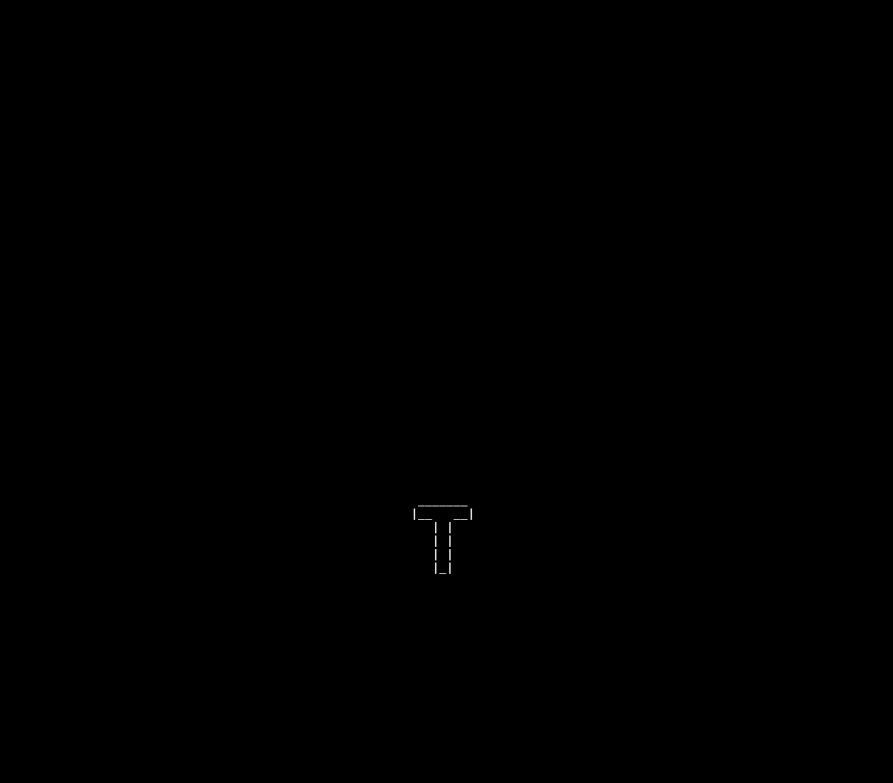
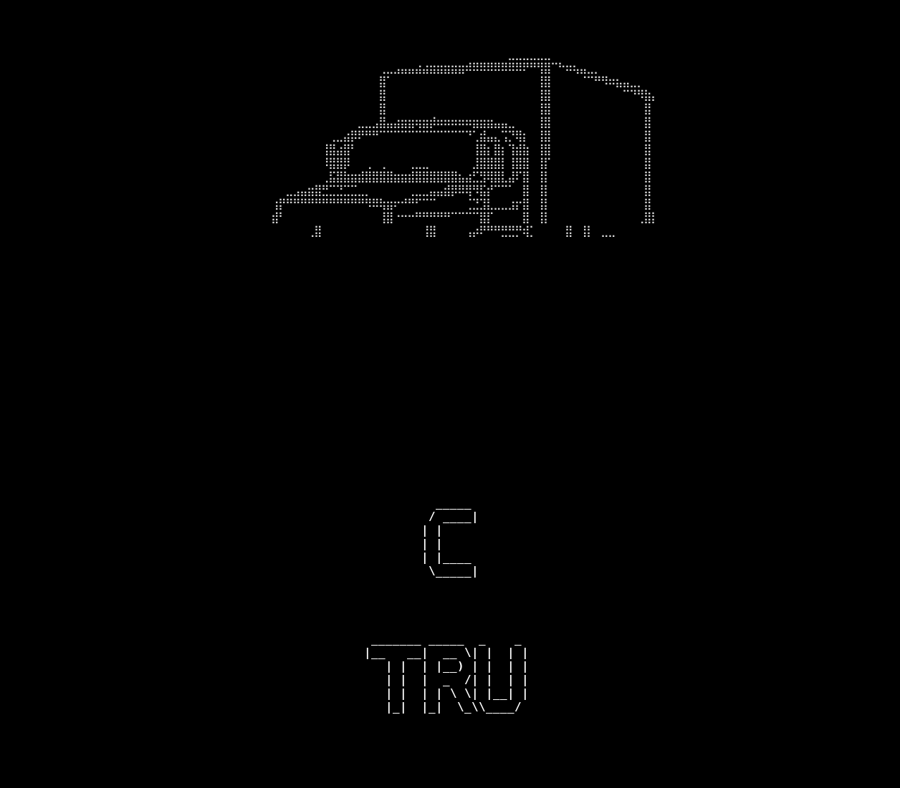
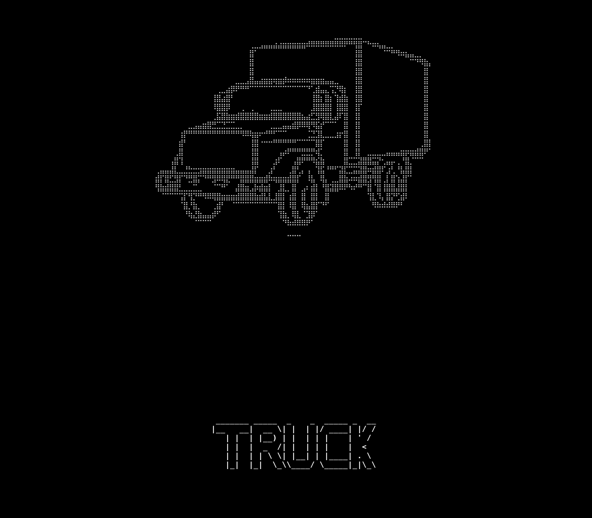

# Typing Game

A big letter shows on the screen. Your child finds it on the keyboard and presses it. A voice says the letter, and a picture shows a little more with each letter. When the word is done, the whole picture shows and the voice says the word. Then a new word starts.







## How it plays

- Only the right key counts. Other keys do nothing. There is no score, no timer and no "wrong" sound.
- Capital and small letters both count.
- After the last letter, the voice says the word, and the picture and the word stay for 3 more seconds. Then a new word starts.
- The game does not pick one of the last 5 words again.
- A parent presses **Esc** to stop the game. On the Raspberry Pi, the game then starts again.

## Words, pictures and voices

The words come from the picture files. There is one word for each file in `assets/ascii/`:

- `assets/ascii/truck.txt` gives the word TRUCK.
- `assets/ascii/cat2.txt` is a second picture for CAT. The game picks one of them at random.
- `assets/ascii/ice-cream.txt` gives ICE CREAM. Your child types `icecream`, and the dash shows as a space.

The voices are WAV files in `audio/`:

```
audio/dad/letters/a.wav        the letter A
audio/dad/letters/a_higher.wav another way to say A (the game picks one at random)
audio/dad/words/truck.wav      the word TRUCK
audio/dad/greeting.wav         plays when the game starts
audio/mom/...                  the same for a second voice
```

The game picks one voice for each word. A word without a sound file is silent. The `audio/` folder is not in git, because it holds your family's voices. See [Customize](../CUSTOMIZE.md) to add your own words, pictures and voices.

## Run it on your computer

You need [uv](https://docs.astral.sh/uv/) and, for sound, `aplay` (from alsa-utils).

```sh
cd typing-game
uv run --with pyfiglet python main.py
```

| Option | What it does |
| --- | --- |
| `--voice dad`, `--voice mom`, `--voice both` | Which voices to use. The default is `both`. |
| `--small-letters` | Show plain letters instead of big ones. |

## On the Raspberry Pi

When the typing game is in [`gadgets.nix`](../gadgets.nix), the Pi logs in at boot and starts the game on the first console (tty1). Sound goes to the 3.5 mm jack on a Pi 4 and to HDMI 0 on a Pi 5. See the [hardware guide](../HARDWARE.md).

## Make voices with a computer

The scripts in `scripts/` copy a voice from a short recording and use it to say every letter, every word and the greeting. They use [Qwen3-TTS](https://pypi.org/project/qwen-tts/) and need an NVIDIA graphics card. See [Customize](../CUSTOMIZE.md#option-b-copy-a-voice-with-a-computer).
